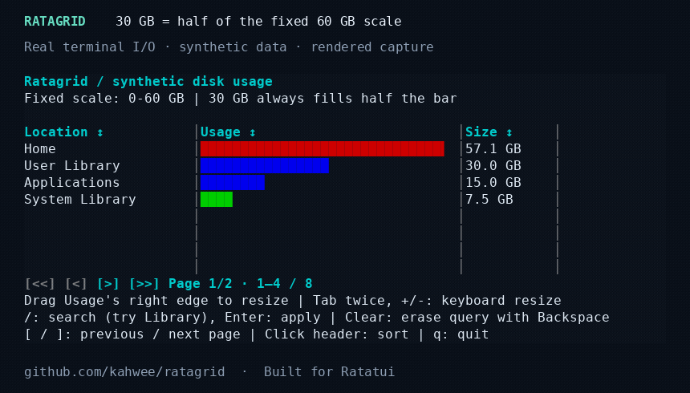

# Ratagrid

An independent, typed data grid for [Ratatui](https://ratatui.rs): sorting, selection, search, column resizing and pagination.


[Documentation and demo](https://kahwee.github.io/ratagrid/) · [crates.io](https://crates.io/crates/ratagrid) · [API reference](https://docs.rs/ratagrid) · [Usage guide](https://github.com/kahwee/ratagrid/blob/main/docs/GUIDE.md)

The demo shows real terminal I/O rendered into media, using synthetic records.

## Run it

Rust 1.99.0 is required.

```sh
git clone https://github.com/kahwee/ratagrid.git
cd ratagrid
cargo run --release --locked --example playground
```

Enable optional full-value panels for truncated cells:

```sh
cargo run --release --locked --example playground -- --cell-details
```

Shrink Workload, then hover a data cell for 500 ms or click it and press Enter. Escape closes the panel; Up/Down, PageUp/PageDown and Home/End scroll a keyboard-opened panel. The mouse wheel over the panel also scrolls it. This option is disabled by default. [Library configuration](docs/GUIDE.md#optional-cell-details).

## Changing datasets and search

The 0.5.0 source release includes batch edits (`update_rows`), optional hashed row
identity (`with_hashed_row_id`) and saved column layouts (`save_layout` /
`restore_layout`). See [updates](docs/UPDATES.md) and [selection/layouts](docs/FEATURES.md).

**New in 0.5.0:** streaming `write_csv` exports filtered, current-page or
selected records; `autosize_columns` fits visible columns with a bounded sample.
See the [report example](examples/report.rs) and [feature guide](docs/FEATURES.md).

Also new in 0.5.0: `append_rows` ingests incoming records without replacing
the dataset; `retain_rows` expires records while preserving surviving selection.
`Column::searchable(false)` excludes expensive fields, and `Column::search_text`
provides search aliases independently of display formatting. These APIs are
included in the v0.5.0 source release.
[Behavior and examples](docs/UPDATES.md#append-and-expire-owned-records) ·
[Measured workloads](docs/benchmarks/live-updates/README.md#append-and-retention-apis).

## Bar chart columns

Ratagrid 0.3.0 includes horizontal bar columns. Try the keyboard-and-mouse demo:

```sh
cargo run --locked --example bar_chart
```

The demo uses synthetic disk usage, colored bars, a separate **Size** column and
four rows per page. Every bar uses the same application-supplied **60 GB** maximum,
including after searching or changing pages. Resize **Usage** with its right-hand
separator, or focus its header with Tab and press `-` / `+`.

Add `.bar_chart(max, value)` to a normal formatted column:

```rust
use ratagrid::{Column, Grid};
use std::num::NonZeroUsize;

const SCALE_GB: f64 = 60.0;
let grid = Grid::new(
    vec![
        Column::new("Usage", 33, |gb: &f64| format!("{gb:.1} GB"))
            .bar_chart(SCALE_GB, |gb| *gb)
            .sortable(|a, b| a.total_cmp(b)),
        Column::new("Size", 12, |gb: &f64| format!("{gb:.1} GB"))
            .sortable(|a, b| a.total_cmp(b)),
    ],
    vec![57.1, 13.3, 8.4, 3.1, 0.2], // Synthetic GB values.
).with_pagination(NonZeroUsize::new(4).unwrap());
```

Choose the scale in your application, such as a fixed capacity or the maximum
across the full dataset. Do not recompute it from the filtered rows or current
page: the same value should keep the same proportion of the column. Resizing
changes the available drawing width; horizontal scrolling clips the bar.

The `Column::new` formatter still provides text for search, copy payloads and
optional full-value details. Sorting is configured separately with `.sortable`,
using the underlying record values. Keep visible numbers in a neighboring column.
See [bar chart columns](docs/GUIDE.md#bar-chart-columns) for styling and edge cases.




## Use with Ratatui

Version 0.5.0 is a GitHub source release; crates.io publication and its docs.rs
build are pending. Use the release tag below. The latest registry release remains
[0.3.1](https://crates.io/crates/ratagrid/0.3.1).

```toml
ratagrid = { git = "https://github.com/kahwee/ratagrid", tag = "v0.5.0" }
ratatui = "0.30"
crossterm = "0.29"
```

Start with the [example guide](examples/README.md) to choose an integration or demo.

A complete keyboard example (`cargo run --locked --example quickstart`):

```rust
use crossterm::event::{self, Event, KeyCode, KeyEventKind, KeyModifiers};
use ratagrid::{Column, Grid};

fn main() -> std::io::Result<()> {
    let mut grid = Grid::new(
        vec![Column::new("Value", 12, |n: &i64| n.to_string()).sortable(|a, b| a.cmp(b))],
        vec![20, -3, 100],
    );
    let mut terminal = ratatui::init();
    let result = (|| {
        loop {
            terminal.draw(|frame| frame.render_widget(grid.widget(), frame.area()))?;
            let input = event::read()?;
            if matches!(&input, Event::Key(k) if k.code == KeyCode::Char('q')
                && k.kind != KeyEventKind::Release
                && !k.modifiers.intersects(KeyModifiers::CONTROL | KeyModifiers::ALT | KeyModifiers::SUPER)
                && !grid.is_searching())
            {
                break;
            }
            grid.handle_event(&input);
        }
        Ok(())
    })();
    ratatui::restore();
    result
}
```

Use arrows to select, Tab + Enter to sort, `/` to search, and `q` to quit. For mouse capture and synthetic financial amounts, see [positions.rs](examples/positions.rs). Your application owns the terminal, focus and data source.

For a SQLite adapter with global search, one-based application pages, optional sorting and changing totals, run `cargo run --locked --example database`; see [the adapter guide](docs/PAGINATION.md#database-adapter-with-one-based-application-pages).

For native database cursor/keyset pagination, use `Grid::new_cursor_paged`, handle `Action::CursorPageRequested`, and return rows plus the next token. Try `cargo run --locked --example cursor`; see the [cursor integration guide](docs/PAGINATION.md#native-cursorkeyset-pagination).

[Feature guide](docs/FEATURES.md) · [Pagination](docs/PAGINATION.md) · [Release notes and migration](CHANGELOG.md#040--2026-10-28-utc) · [Contributing](CONTRIBUTING.md) · [MIT license](LICENSE)

## GitHub benchmarks

Benchmarks run across Linux, macOS and Windows when a PR opens ready for review,
when a draft becomes ready, weekly on Mondays at 09:17 UTC, or manually. They do
not run on ordinary pushes or subsequent PR commits. Correctness CI still checks
all three platforms on every push and PR update.

<!-- github-benchmarks:start -->

Measured 2026-10-26 on GitHub-hosted runners at [`e2fee5f`](https://github.com/kahwee/ratagrid/commit/e2fee5f2cf47400f9aa3306717777ba2484b4779). [Workflow and logs](https://github.com/kahwee/ratagrid/actions/runs/40355678181/attempts/1) · [Raw CSV/JSON](docs/benchmarks/github/runs/40355678181-1).

| Runner | 1M draw | 1M numeric sort | 1M: 50 large moves + draw | 100M virtual / 50 resident draw | Fresh / warm Cargo stages |
| --- | ---: | ---: | ---: | ---: | ---: |
| ubuntu-24.04 (x86_64) | 0.119 ms | 117.033 ms | 28.428 ms | 0.111 ms | 27.03 s / 1.85 s |
| macos-15 (arm64) | 0.109 ms | 98.078 ms | 20.355 ms | 0.101 ms | 35.97 s / 2.77 s |
| windows-2025 (AMD64) | 0.164 ms | 234.690 ms | 27.985 ms | 0.160 ms | 46.63 s / 3.50 s |

Release-mode, in-memory runtime medians from three process runs; terminal I/O and real database/network work excluded. Build timings cover Clippy, tests, doctests and rustdoc with pre-fetched dependencies; setup and release compilation excluded. Fresh/warm build figures are medians of two runs each. Compare within a platform; hosted hardware/load varies.

- ubuntu-24.04: Compared with frozen baseline 9617519. 11 possible runtime regression(s).
- macos-15: Compared with frozen baseline 9617519. 0 possible runtime regression(s).
- windows-2025: Compared with frozen baseline 9617519. 5 possible runtime regression(s).

Slowdown warnings require both >25% and >0.05 ms; paired runs use the same-runner reference, otherwise the frozen baseline. They are advisory. [Method, triggers and baseline policy](docs/BENCHMARKS.md).

<!-- github-benchmarks:end -->

## CI maintenance

[GitHub Actions maintenance](.github/ACTIONS.md) covers workflows, parallel checks, action versions, and weekly updates.

## Maintaining and releasing

Start with [CONTRIBUTING.md](CONTRIBUTING.md). The [release runbook](docs/RELEASING.md)
and [agent release skill](.agents/skills/ratagrid-release/SKILL.md) share one local
check/package helper and explain versioning, CI, publication and recovery. See
[GitHub Actions maintenance](.github/ACTIONS.md) for verified action references.
