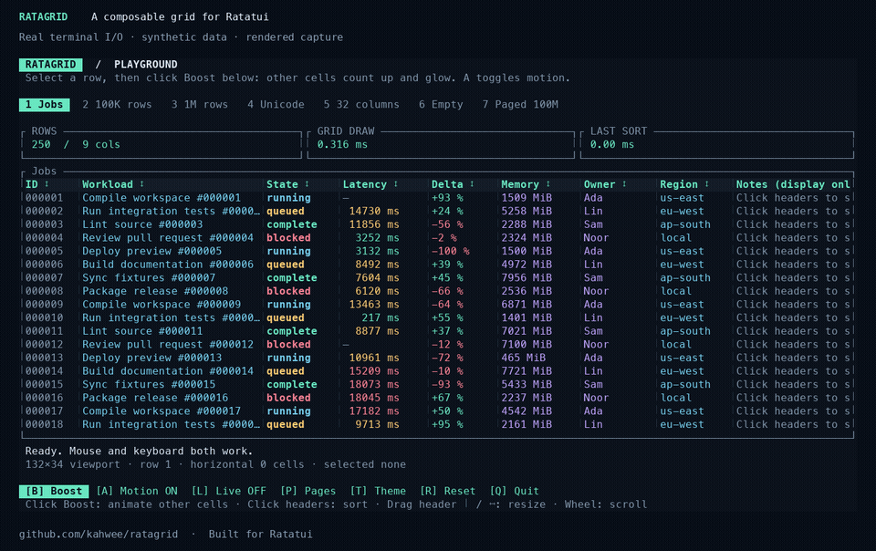

# Ratagrid

A typed data grid for [Ratatui](https://ratatui.rs): mouse and keyboard selection,
sorting, search, resizable columns and resident or external pagination.
Applications own terminal setup, focus, I/O and persistence.



[Documentation and demo](https://kahwee.github.io/ratagrid/) ·
[API reference](https://docs.rs/ratagrid) · [Examples](examples/README.md)

## Run it

Use Rust 1.99+; the checkout selects 1.99.1:

```sh
git clone https://github.com/kahwee/ratagrid.git
cd ratagrid
cargo run --release --locked --example playground
```

Use arrows or click to select, Tab + Enter to sort, `/` to search and `q` to quit.
Drag column separators or use `-` / `+` on a focused header to resize. Optional
full-value panels are enabled with `-- --cell-details`; see the [usage guide](docs/GUIDE.md).

## Use with Ratatui

The [0.5.0 GitHub source release](https://github.com/kahwee/ratagrid/releases/tag/v0.5.0)
includes `append_rows`, `retain_rows`, per-column search, streaming CSV reports
and bounded Unicode-aware column autosizing. It is available on
[crates.io](https://crates.io/crates/ratagrid/0.5.0) and [docs.rs](https://docs.rs/ratagrid/0.5.0/ratagrid/).
Main prepares the compatible **0.5.1** dependency/tooling maintenance release.

Use the published 0.5 line and retain Cargo.lock:
```toml
[dependencies]
ratagrid = "0.5"
ratatui = "0.30"
crossterm = "0.29"
```

```rust
use ratagrid::{Column, Grid};

let mut grid = Grid::new(
    vec![Column::new("Value", 12, |n: &i64| n.to_string())
        .sortable(|a, b| a.cmp(b))],
    vec![20, -3, 100],
);
// Draw grid.widget(), then forward input with grid.handle_event(&event).
```

Start with [quickstart](examples/quickstart.rs) for a complete event loop,
[positions](examples/positions.rs) for application-owned numeric formatting,
[database](examples/database.rs) for SQLite, or [report](examples/report.rs) for
noninteractive CSV. Render before forwarding mouse events so hit-testing uses
the current layout.

- [Features, CSV and autosizing](docs/FEATURES.md) · [updates and row identity](docs/UPDATES.md)
- [Pagination and database adapters](docs/PAGINATION.md) · [bar-chart columns](docs/GUIDE.md#bar-chart-columns)
- [Performance](docs/PERFORMANCE.md) · [changelog](CHANGELOG.md)
- [Contributing](CONTRIBUTING.md) · [release runbook](docs/RELEASING.md) · [agent guide](AGENTS.md)

## GitHub benchmarks

The recorded figures below describe their linked source and runner, not the
prepared release. [Method, triggers and baseline policy](docs/BENCHMARKS.md).

<!-- github-benchmarks:start -->

Measured 2026-10-26 on GitHub-hosted runners at [`e2fee5f`](https://github.com/kahwee/ratagrid/commit/e2fee5f2cf47400f9aa3306717777ba2484b4779). [Workflow and logs](https://github.com/kahwee/ratagrid/actions/runs/40355678181/attempts/1) · [Raw CSV/JSON](docs/benchmarks/github/runs/40355678181-1).

| Runner | 1M draw | 1M numeric sort | 1M: 50 large moves + draw | 100M virtual / 50 resident draw | Fresh / warm Cargo stages |
| --- | ---: | ---: | ---: | ---: | ---: |
| ubuntu-24.04 (x86_64) | 0.119 ms | 117.033 ms | 28.428 ms | 0.111 ms | 27.03 s / 1.85 s |
| macos-15 (arm64) | 0.109 ms | 98.078 ms | 20.355 ms | 0.101 ms | 35.97 s / 2.77 s |
| windows-2025 (AMD64) | 0.164 ms | 234.690 ms | 27.985 ms | 0.160 ms | 46.63 s / 3.50 s |

Release-mode, in-memory runtime medians from three process runs; terminal I/O and real database/network work excluded. Build timings cover Clippy, tests, doctests and rustdoc with pre-fetched dependencies; setup and release compilation excluded. Fresh/warm build figures are medians of two runs each. Compare within a platform; hosted hardware/load varies.

- ubuntu-24.04: Compared with frozen baseline 9617519. 11 possible runtime regression(s).
- macos-15: Compared with frozen baseline 9617519. 0 possible runtime regression(s).
- windows-2025: Compared with frozen baseline 9617519. 5 possible runtime regression(s).

Slowdown warnings require both >25% and >0.05 ms; paired runs use the same-runner reference, otherwise the frozen baseline. They are advisory. [Method, triggers and baseline policy](docs/BENCHMARKS.md).

<!-- github-benchmarks:end -->

[CI maintenance](.github/ACTIONS.md) · [MIT license](LICENSE)
